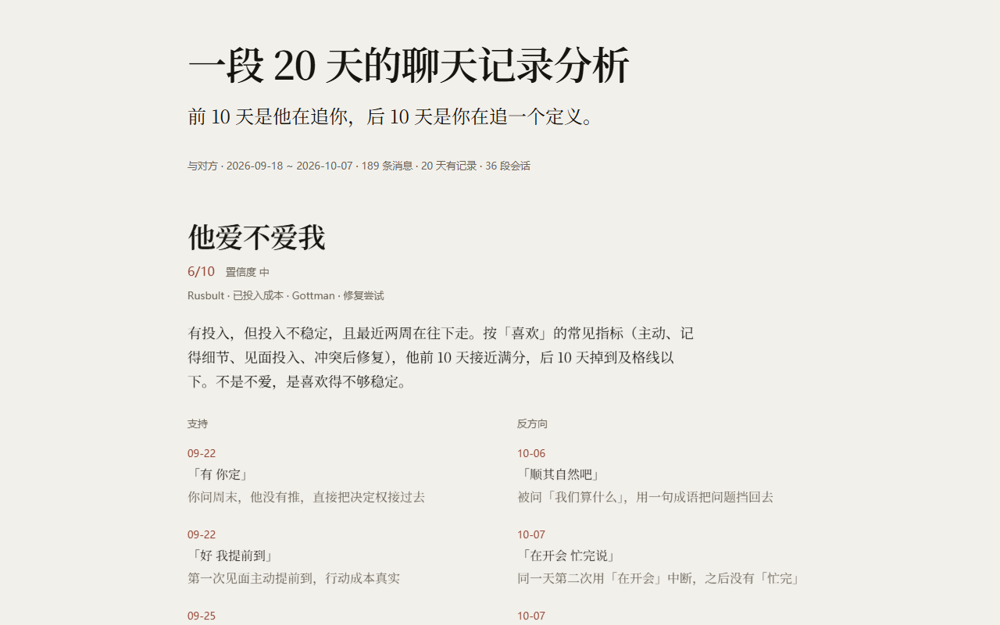

# chat-log-analysis




把一段聊天记录变成一份**有证据的关系报告**。

不是算命：每条判断都挂在原文上，引用逐字校验，编造的话进不了报告；每个结论都标了用的是哪个研究框架、置信度有多高。

```
聊天记录 → 采集 → 指标 → 框架 → 判断 → 证据校验 → 网页报告
```

## 仓库里有什么、没有什么

**没有**：任何人的聊天记录、分析结果、API Key、wxid、本机绝对路径。
`examples/` 是一份 20 天的**合成**对话（虚构人物），只为跑通流程。

**有**：`vendor/` 里的取密钥工具（第三方，MIT）。它会从**正在运行的微信进程**读取数据库密钥，
只对你自己登录的账号有意义——密钥不写盘、不联网，只在内存和临时文件里存在几十秒，
解密出的副本在分析结束后删除。没有微信运行时它什么也读不到。

`tools/verify_clean.py` 会扫前一类东西，CI 每次提交都跑一遍：

```bash
python tools/verify_clean.py
# [OK] 干净：没有运行产物、密钥、wxid 或本机路径。
```

## 它能做什么

- **回答三个问题**：他爱不爱我 / 是不是渣 / 该不该分——给判断、给分数、给证据、给反方向证据
- **也描述关系**：互动模式、情绪走势、话题变化、关系阶段、红旗清单
- **给建议**：不是「你要爱自己」，是「下次别问我们算什么，给他二选一」

## 它不做什么

- 不解密微信数据库、不从进程里取密钥（那不是分析，是另一类工具）
- 不贴人格标签（NPD、回避型依恋），只描述行为
- 不教操控
- 不上传原文，没有服务端，没有账号

## 快速开始

```bash
# 0 采集（三选一）
python scripts/ingest.py --contact 小林 --lane wcdb --out work/chat.jsonl        # 直接读本机微信
python scripts/ingest.py --contact 小林 --lane snapshot --snapshot-dir "D:\wechat_data\账号" --out work/chat.jsonl
python scripts/ingest.py --contact 小林 --lane clipboard --out work/chat.jsonl
python scripts/normalize.py chat.txt --self 我 --out work/chat.jsonl

# 1 确定性部分：体检 → 指标 → 分片
python scripts/run_all.py work/chat.jsonl --self 我 --out work

# 2 让模型读 work/shards/*.txt，按 references/rubric.md 写 analysis.json
#    （结构见 SKILL.md，示例见 examples/analysis.example.json）

# 3 证据校验：任何一条引用对不上原文就不许出报告
python scripts/check_evidence.py work/chat.jsonl analysis.json

# 4 出报告（默认脱敏对方姓名）
python scripts/render_report.py --stats work/stats.json --profile work/profile.json \
  --keywords work/keywords.json --analysis analysis.json \
  --out work/report.md --html work/report.html
```

样例在 `examples/`：20 天的合成聊天 + 对应的判断层，可以直接跑通全流程。

## 采集通道

| 通道 | 前提 | 说明 |
|---|---|---|
| `wcdb` | Windows + 微信已登录 + 版本白名单 | 从本机微信读，含语音转写；需读进程内存取密钥 |
| `snapshot` | 一个**已解密**的微信数据目录（`contact/` + `message/`） | 最省事；不解密、不碰进程 |
| `clipboard` | `pip install pywin32` | 在微信里多选复制，脚本合并去重 |
| `normalize` | 无 | 微信/WhatsApp/通用 JSONL 都能吃 |
| `ocr` | 未实现 | 占位，会明确报错 |

`wcdb` 会先要求确认「我是这段对话的当事人之一」，并比对微信版本；版本不在白名单会拒绝执行并建议改用 `clipboard`。详见 [PRIVACY.md](PRIVACY.md)。

想接自己的数据源：实现 `sources/base.py` 里的两个方法，见 [sources/README.md](sources/README.md)。

## 语音转写（可选）

**不开启也能分析**：文字消息照常，只是语音部分没有内容，报告里显示为 `[语音]`，
并在「看不到什么」里注明「N 条语音未转写」。

要连语音一起分析，需要**阿里云百炼的 API Key**：

1. 打开 [阿里云百炼控制台](https://bailian.console.aliyun.com/) → 右上角选地域 →
   **API-KEY** → 创建（那串 key 只显示一次，先存好）
2. 设环境变量 `DASHSCOPE_API_KEY`，或传 `--asr-key`
3. 采集时加 `--asr dashscope`

```bash
python scripts/ingest.py --contact 小林 --lane wcdb --asr dashscope
```

**音频会上传**：每条语音解码成 wav 后发给阿里云百炼的语音识别服务，不是本地处理。
没有 Key 时程序会停下并打印这三步，不会偷偷降级；采集完发现语音未转写也会再提示一次。
Key 只从环境变量或参数读取，不写入任何文件。

## 分析框架（这是它和"让 AI 随便聊聊"的区别）

判断不是凭直觉，每一条都挂一个理论构念。`references/frameworks/` 有六份可操作的指南：

| 文件 | 框架 | 用来回答 |
|---|---|---|
| `00-index.md` | 索引 | 什么问题用哪套理论、证据强度怎么分 |
| `01-attachment.md` | 依恋理论 | 为什么忽冷忽热、为什么越问越退 |
| `02-gottman.md` | Gottman 四骑士与修复尝试 | 为什么吵架伤人、谁先递台阶 |
| `03-investment.md` | Rusbult 投入模型 | 他为什么不走、你为什么不走 |
| `04-communication.md` | 追—逃、连接邀请、自我披露 | 为什么聊不下去、谁在维持对话 |
| `05-stages.md` | Knapp 关系阶段 | 你们卡在哪一步 |
| `06-context-cn.md` | 中文语境与偏差校正 | 催婚压力、家庭介入、单方视角 |

三条使用规则：**框架只组织观察、不下诊断**；每条判断至少挂一个构念；标注证据强度（强/中/弱）。

## 交付物

`report.html`：单文件、零依赖、可离线打开。六个字号、三种视觉手段（大字、墨色色场、数据图），
刻意只做一套模板。数据图是从记录里算出来的，不是装饰：

- 按天的活跃度格子（空白就是那段没聊天的日子）
- 最忙一天的节奏条（两行分人，挤压处就是追与等）
- 按周回复速度折线、双方对比条

`report.md` 是同一份内容的纯文本版。

## 模拟对话（实验功能）

分析完还能接着聊：先把记录蒸馏成一份**说话档案**，再用你自己的模型扮演对方。

```bash
python scripts/persona.py work/chat.jsonl --stats work/stats.json --out persona.json
python sim/sim.py --persona persona.json      # 打开 http://127.0.0.1:8777
```

界面是一个只有这条会话的微信窗口：气泡、正在输入、已读不回都在。回复快慢按她的**真实时延分布**采样
（你这份是 P50 10 秒、P90 7 分钟），说话长度按她的平均字数收敛，有概率不回——真实聊天里她本来就不总回。

配置只要**一个 API Key**：点右上角 ⚙ 粘进去、点连接。程序会拿这把 key 挨家试
（DeepSeek / 阿里云百炼 / Kimi / 智谱 / OpenAI），谁认就用谁，不用你选服务商和模型。
自建或小众服务点「手动设置地址和模型」。

| 从记录里蒸出来的 | 用在哪 |
|---|---|
| 平均字数、单双字占比 | 回复长度 |
| P10/P50/P90 时延 | 隔多久才「正在输入」 |
| 主动开场率、连发率、反问率 | 互动节奏（她几乎从不主动，64% 会连发） |
| 语气词、口头禅、表情占比 | 说话形状 |
| 真实对答片段（10 组） | few-shot，学语气不学台词 |
| 性格标签（带数字依据） | 「被动」「爱连发」「回避正面回应」 |
| 情绪曲线 | 基线 + 情绪高/低的那几天 |
| 她亲口说过的事实 | 记住「亏了 66000」这类具体细节 |
| 原始记录全文 | 每次回复前检索相关旧事，注入上下文 |

**防编造**：生成后检查有没有出现上下文里没有的数字，有就重写一次，再不行就删掉那句。

注意：

- API Key 只存在**你的浏览器** localStorage，随请求透传，本地服务不写盘、不记日志
- `persona.json` 里有原文片段，已进 `.gitignore`，不要提交
- 界面固定标注「模拟对话 · 基于 N 条记录生成，不是本人」
- 生成的回复**不要转发给对方**：那是模型写的，不是那个人说的

## 隐私

- 全流程本地，原文不出机器；没有服务端、没有遥测
- 语音默认不转写；`--asr` 需要你自己提供云端 ASR key，且要先确认
- 报告默认脱敏对方姓名；没有分享按钮
- 中间产物（`work/chat.jsonl`、`work/shards/`）含原文，交付后请自行删除

细节见 [PRIVACY.md](PRIVACY.md)。

## 边界与免责

- 只支持一对一私聊；群聊需先指定两个人
- 样本 < 300 条时只做描述，不做趋势
- 框架来自公开的亲密关系研究，样本以西方已婚异性恋夫妻为主，跨文化适用性有限
- **这是探索性分析，不是心理诊断，也不能替你做决定**

## 装成 skill

```bash
git clone https://github.com/<you>/chat-log-analysis ~/.claude/skills/chat-log-analysis
# 或 ~/.kimi-code/skills/ 、DSH 的 skills 目录
```

之后对 agent 说「分析一下我和 XX 的聊天记录」就会触发。

## 依赖

Python 3.9+。核心分析只用标准库；`zstandard` 读数据库需要，`jieba` 可选（没装退回二元组），
`pywin32` 只有剪贴板通道需要。

## License

MIT
